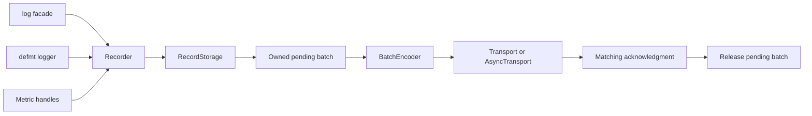

# Agent architecture

Status: initial implementation. Scope: raw logs, defmt logs, numeric metrics and
boots. Crash capture is deliberately deferred. The agent is a Rust library;
applications own hardware, tasks, networking and credential provisioning.

## Workspace

| Crate | Responsibility | Target |
| --- | --- | --- |
| `sparkly-agent` | Recorder, global facades, metric handles, exporter | `no_std`, no allocator |
| `sparkly-core` | Domain values, enrollment lifecycle and storage/clock/backtrace/transport/encoder contracts | `no_std`, no allocator |
| `sparkly-protocol` | Bounded micropb codec generated from `agent/proto/parcel.proto` | `no_std`, no allocator |
| `sparkly-macros` | Compile-time metric IDs and ELF dictionary records | Build host proc macro |
| `sparkly-build` | Shared ELF validation and post-link finalization | Build host |
| `sparkly-cli` | `sparkly` setup/inspection and `sparkly-link` linker wrapper | Build host |
| `sparkly-linux` | Monotonic clock, backtraces, HTTP transport, filesystem identities and rustls HTTPS/mTLS | Linux, `std` |
| `sparkly-host-example` | Simulated device, enrollment setup, HTTP export and defmt linker settings | Linux application |
| `sparkly-esp` | ESP32-S3 clock, backtrace and reset reason; portable build-ID reader | Xtensa adapter |

The portable crates do not depend on ESP, Embassy, Tokio or a particular network
stack. HAL dependencies are target-specific and opt-in. The standalone ESP
example has its own workspace, lockfile and target configuration.



## Capture and concurrency

`Recorder<S, C, B>` combines interchangeable `RecordStorage`, `Clock` and
`Backtrace` implementations. `Sink` is the object-safe facade interface;
`BatchSource` is the single-consumer exporter interface. Direct access requires
no globals. `install()` binds metric macros and defmt to a static sink;
`install_log()` separately selects Sparkly as the `log` backend. Existing log
backends can forward to `Sink::text` without surrendering the application's
global logger. Facades used before installation discard telemetry.

Raw text is formatted immediately into an owned 256-byte UTF-8 string, with a
64-byte target, captured addresses and a truncation flag. Borrowed format
arguments never escape the log call. Each accepted raw log attempts synchronous
backtrace capture. `NoBacktrace` explicitly reports unsupported capture.
Timestamps are sampled when a record is committed under the storage lock, so
interleaved formatting cannot make timestamps run backwards within one boot.

A recorder guard rejects nested or concurrent log formatting, counting the loss.
It prevents recursive user `Display` implementations from deadlocking. Raw
formatting and stack walking occur outside the recorder's storage lock. Arbitrary
user formatting is not guaranteed to have bounded execution time.

The defmt adapter is opt-in and owns the sole global logger. It holds the
platform critical section over acquire/write/release, encodes all fragments
through `defmt::Encoder`, and commits exactly one complete frame. Overflow drops
the entire frame and resets for the next frame. Its 512-byte staging area is
static. This simple design increases interrupt latency; per-context channels
are a measured future optimization. Neither facade's `flush()` performs I/O
inside the logging context; applications drive the exporter explicitly.

`critical-section` supplies synchronization. Applications select a provider
appropriate for their CPU and execution model. ESP32-S3 requires the HAL's
multicore-aware implementation. Ordinary interrupt-safe capture does not imply
NMI/fault-handler safety. No crash handler is part of this implementation.

## Storage and memory

`RingStorage<B>` is a bounded FIFO of packed, variable-length records over a
pluggable `ByteStorage` provider. `ByteStorage` exposes stable immutable/mutable
byte slices. Arrays, borrowed mutable slices, `Vec<u8>` and `Box<[u8]>` work via a
blanket implementation for `AsRef<[u8]> + AsMut<[u8]> + Send`. Custom providers can
implement the trait directly. The provider must expose the same exclusive memory
with a fixed positive length and bounded, nonblocking, infallible access.

`RamStorage<N>` remains an alias for `RingStorage<[u8; N]>`, with the same const
`new()` constructor. `N` is a byte budget including framing, not a record count.
`RamStorage<2048>` reserves 2048 bytes plus head/length counters and alignment
padding. Strings, defmt frames and traces occupy only their actual lengths.

```rust
// Inline RAM, unchanged:
let inline = RamStorage::<2048>::new();

// Caller-provided memory, without moving a large array into the recorder:
let mut bytes = [0u8; 2048];
let borrowed = RingStorage::with_storage(&mut bytes[..]);

// Heap allocation belongs to the application, before capture:
let heap = RingStorage::with_storage(vec![0u8; 2048].into_boxed_slice());
```

The portable library still requires no allocator. For a Vec provider the budget
is its length, not allocation capacity; the ring never resizes it or allocates.
`with_storage()` starts an empty queue without clearing the backing bytes and
rejects zero capacity. `into_backing()` returns the provider but discards ring
metadata; rewrapping those bytes does not recover previous records. Preserve the
whole `RingStorage` when handing a live queue to another recorder.

| Record | Stored bytes |
| --- | --- |
| Metric (gauge or counter delta) | 28 |
| Text | 19 + target bytes + message bytes + 8 per captured address |
| defmt | 15 + frame bytes + 8 per captured address |
| Boot | 36 + all four metadata string lengths + 4 if a raw reset reason is present |

These sizes include a two-byte total length, payload tag and timestamp. The
private RAM encoding is independent of Rust layout and is not a persistent or
network format. `used_bytes()`, `capacity_bytes()` and `record_size(&record)`
expose queue sizing information. A `Record` is still materialized temporarily
on capture/pop, and the exporter's owned batch still uses fixed-size records.

The queue is a circular byte buffer with a head index and occupied-byte count.
Records, including their length headers, may wrap across the end. Append writes
only the incoming record; pop decodes directly from up to two slices and advances
the head. Neither operation compacts or moves other queued records, and decoding
needs no additional full-record scratch buffer.

When space is needed, the queue evicts as many oldest complete records as necessary,
including Boot records, then appends the new record. A record larger than the byte
budget returns `StorageFull` without changing history. Eviction statistics count
records, not bytes, and include evicted Boots. Eviction decodes each removed
record to retain Boot context before advancing the head. The ring also owns one
optional Session outside its byte buffer; each pending batch owns a context copy.
The host and ESP examples use a 2048-byte queue.

Limits: text 256 bytes, target 64 bytes, defmt 512 bytes, trace 16 addresses,
batch eight stored events, including any Boot events. These limits are explicit in
`sparkly-core` and the protocol generator; changes require round-trip tests.
An exporter defaults to an 8192-byte encoding buffer and also retains an owned
batch. Account for both when sizing RAM and the task stack. The protocol encoder
streams one generated Event at a time instead of constructing a second Parcel.

Storage methods execute under the recorder's critical section. They must be
bounded, nonblocking and non-reentrant; a failed push must preserve existing
records. Flash erase/write does not satisfy this capture-path contract. A flash
journal should use RAM staging and a separate worker/durable outbox contract.
These are two extension levels: `ByteStorage` changes memory ownership/location
under the shared ring; `RecordStorage` changes the record queue itself. A flash
adapter can use `RingStorage` for its capture staging, with a worker handling
erases, alignment, failed writes, wear and power-loss recovery. Direct raw flash
is not supported by the mutable-slice interface. Flash drivers and durable ring
metadata/recovery are not implemented by this memory abstraction.

`Recorder::new()` appends one new Boot after any restored records before accepting
telemetry. Appending the Boot may evict older records, including other Boots.
It is fallible: if the reset exceeds the byte budget or a custom storage write
fails, `RecorderInitError` returns the original storage intact. The ESP initializer
also returns storage on build-ID or session validation failures. Applications must
provide sufficient capacity or recover storage and retry before continuing capture.
`into_storage()` returns queued records for recovery or handoff; it does not
include a batch already owned by an exporter.

All current storage and pending batches are volatile. Dropping an exporter or
resetting the device loses its in-flight batch. An exporter owns at most one
pending batch, so repeated failures do not grow memory use.
Cross-boot tests reuse a restored queue to check ordering; a production flash
implementation and persistent pending parcels are still future work.

## Export and acknowledgment

`BatchEncoder` abstracts serialization. The supplied `ProtobufEncoder` uses
micropb 0.6 with fixed containers and no allocator. `Transport` and
`AsyncTransport` accept immutable bytes and a batch ID. They own connection
setup, framing, authentication and timeouts, returning an acknowledgment only
after the configured recipient accepts the batch durably.
There must be one ordered delivery stream per device. The backend atomically
applies a parcel's events, updates active boot/build context, and records its ID
before acknowledging it. Duplicate retries must not reapply Boot reset events.

`Exporter::poll()` / `poll_async()` attempt work at the configured interval;
`flush()` / `flush_async()` request an immediate attempt. There is no hidden task,
timer, sleep or executor. Current retries use the same fixed interval; jitter,
backoff and size-triggered wakeups remain future work. Async cancellation keeps
the pending batch. A transport must tolerate retransmission after cancellation.

Records move out of storage into an owned pending batch before encoding. An
encoding error keeps the batch. A send failure or wrong acknowledgment keeps
both the batch and its exact bytes. Only a matching acknowledgment releases it.
Concurrent producers can continue and evict queued records without changing the
pending batch. This is at-least-once transmission of retained records, requiring
backend deduplication; bounded RAM does not guarantee lossless delivery.
On restart, a durable outbox must replay pending parcels with their original IDs
before any newly assembled parcel. It must transfer queue ownership to a durable
parcel atomically, so retained records cannot disappear between queue and outbox.

## Boot context and protobuf

Applications supply a fresh random 128-bit ID in each `Boot.boot_id`. A Boot event
always represents an actual startup/reset. It carries firmware version, the
agent version recorded at startup, build ID, reset description and optional
hardware reason code. Stored metadata is serialized unchanged even after a
firmware update; the codec does not substitute its current version.

`Parcel.initial_boot` is a singular Boot message describing context immediately
before its first event. It is repeated metadata, not a reset event. Boot events
replace the active context for subsequent events. The byte ring retains the last
Boot removed from its head, whether popped for export or evicted, separately from
its byte budget. This context survives `into_storage` handoff and is copied into
the owned pending batch, keeping retries independent of later capture.
Custom `RecordStorage` implementations must return the equivalent context through
`initial_boot`; the default is unknown. Never substitute the current firmware
for unknown restored history. A first Boot event establishes context even when
the header is absent. Evicted events still count as losses.

For streams with intact boot context, a parcel may contain old-boot events, a new
reset, and new-boot events.
It may also contain only ordinary events whose boot context was accepted in a
previous parcel. Each parcel carries the corresponding initial context. For example:

```text
parcel A [initial_boot: unknown]: Boot(X), Log, Metric
parcel B [initial_boot: X]: Log, Boot(Y), Log
parcel C [initial_boot: Y]: Metric
```

The first event in B still belongs to X; its final log and all of C belong to Y.
Random boot IDs identify resets; order comes from parcel delivery and positions
in `repeated events`. Uptime resets at each Boot and is not a wall clock across
power-off. No per-event or persistent boot sequence is required. Field numbers
are consecutive; this initial schema does not maintain backwards compatibility.

Batch IDs use the producer's boot ID plus a local 64-bit counter solely for
deduplication. They do not describe the boot context of their contents and must
not be used to sort parcels. The counter errors on exhaustion rather than
reusing an ID. Persisted parcels retain their original IDs after reboot.

`dropped_records` counts evictions/rejections since the previous parcel was
assembled. This is a parcel-level loss delta, not an attribution to one boot.
The backend adds it once after parcel deduplication. New losses can produce an
empty-events parcel, but never synthesize another reset. The public recorder
statistics remain cumulative for that recorder instance.

Metrics use `double gauge` or `uint64 counter_delta`. Delta counters
require deduplication before aggregation and lose increments if records are
evicted. Histograms and cumulative counter aggregation are not implemented.

The Crash wire definition is retained for future implementation, but no runtime
API emits it. Required-payload checks belong in
the ingest validator: the agent schema now uses ordinary protobuf without
protovalidate extensions, allowing standalone `protoc`/micropb builds. Receivers
must reject absent payloads, invalid identities, unsupported values and excessive
lengths rather than treating generated decoding as semantic validation.

## Build IDs and ELF dictionaries

`sparkly init --chip esp32s3` configures an existing firmware project's dependencies
and Cargo target linker. The current unpublished SDK uses `--sdk-path` for local
dependencies. Normal `cargo +esp build` then invokes the installed `sparkly-link`,
which delegates to the real toolchain driver and finalizes the output before
returning success. No application build.rs or copied HAL layout is required.

The portable runtime contains a fixed-size read-only static exported as
`__sparkly_build_id`. It is placed by the HAL's normal `.rodata` handling. The
wrapper adds a small non-allocatable metadata script and `--build-id=sha1`, then
reads the generated GNU note and copies the ID into that slot in the ELF. It
never changes load addresses, section sizes or instructions. Its finalizer first
validates the note, slot bounds, readonly/loadable placement, and metric metadata;
only then does it atomically replace the ELF while preserving permissions.

The slot layout is `SPID` (4 bytes), version (1 byte, currently 1), ID length
(1 byte, initially zero), reserved (2 bytes), and ID storage (32 bytes, zero
padded). `build_id()` uses a volatile load so LTO cannot substitute the initial
zero values. A length of zero returns `BuildIdError::NotFinalized`. The same
reader is used on Linux and ESP; there is no platform memory-map override.

`.note.gnu.build-id` and `.sparkly.metrics` remain ELF-only. GNU ld may label an
INFO note as PROGBITS while LLD keeps SHT_NOTE; the extractor supports both by
reading and validating the named GNU note. The GNU note is left unchanged by
finalization. The resulting ID identifies the original link with its placeholder;
it is not a checksum of the post-processed file. Identical reproducible inputs
produce the same ID; source equality alone does not guarantee reproducibility.

The wrapper forwards arguments without a shell, including GNU response files,
and preserves real linker errors. Recursion, unsupported slot layouts and failed
validation fail the build. Uninstrumented artifacts can pass through without a
runtime slot. `sparkly finalize` exposes the same idempotent operation for manual
pipelines. Finalize before image conversion/compression/signing; retain and upload
the finalized unstripped ELF. Symbol stripping before finalization is rejected.
`sparkly inspect` verifies matching note/runtime IDs and prints the dictionary.

A build ID is a lookup key, not a security digest. The backend must independently
hash the final uploaded ELF and reject conflicting artifacts under the same ID.

`metric!("cpu.temperature")` yields a gauge handle containing FNV-1a-64 over the
exact UTF-8 name. `counter!("requests.completed")` yields a counter-delta handle.
There is no runtime hashing or dynamic name registry. IDs are decoded under the
firmware build ID, and the backend can group names across firmware versions.

Each macro also emits one byte-packed `.sparkly.metrics` entry:

| Bytes | Meaning |
| --- | --- |
| 0..4 | ASCII `SPKM` |
| 4 | Metadata version, currently 1 |
| 5 | Kind: 1 gauge, 2 counter delta |
| 6..8 | UTF-8 name length, little-endian u16 |
| 8..16 | ID, little-endian u64 |
| 16.. | Name bytes, no terminator |

The linker retains the dictionary as non-allocatable metadata. Names occupy ELF
space, not flashed program space. The host inspector verifies this and rejects
hash collisions, malformed records and conflicting kinds. Duplicate identical
declarations are allowed. Run inspection before release, not only at ingestion.
Units, labels and a versioned metadata evolution strategy are future work.

Linker build IDs do not necessarily cover every change to non-loaded metadata.
Release pipelines must reject artifact-digest conflicts; a Git commit alone is
not an adequate firmware identifier. Alternate canonical hashing is future work.

## Planned security boundaries

Direct internet connections use backend mTLS. A bridge receives an application
signed protobuf parcel and handles its server connection. The proposed envelope
is COSE_Sign1 over the original protobuf bytes; verification must not reserialize
protobuf. The backend resolves the signing certificate, verifies device/tenant
authorization and deduplicates boot/batch IDs. Signing does not hide telemetry
from the bridge. Acknowledgment trust and offline replay retention are protocol
decisions to settle before implementing bridge delivery.

Enrollment uses a revocable, scoped firmware token. On first connection the
device durably stores a generated private key, signs a CSR and exchanges the
token for a device certificate. Retries with the same key must be idempotent.
Shared token revocation stops future enrollment; existing certificate/device
revocation is separate. Bridge-based enrollment must explicitly decide whether
the bridge may see the token. Credential storage, signing, certificate rotation,
TLS clock policy and secure flash are not implemented in this scaffold.

## References

- [micropb](https://github.com/YuhanLiin/micropb)
- [defmt logger contract](https://docs.rs/defmt/latest/defmt/trait.Logger.html)
- [critical-section providers](https://docs.rs/critical-section/latest/critical_section/)
- [GNU build IDs](https://sourceware.org/binutils/docs/ld/Options.html)
- [Protobuf serialization is not canonical](https://protobuf.dev/programming-guides/serialization-not-canonical/)
- [COSE Sign1](https://www.rfc-editor.org/rfc/rfc9052.html)

## Identity lifecycle

`sparkly-core::identity` provides the portable enrollment lifecycle without heap
allocation or additional dependencies. It shares core's `no_std` contract. `CredentialStore` supplies exclusive credential storage and
`IdentityBackend` supplies key generation, signing, authenticated enrollment and
validated client construction. Associated types allow fixed buffers or opaque
secure-element handles; PEM, a filesystem and rustls are not required by the
shared lifecycle. Backends perform trust/time/client-auth/key-correspondence
validation; storage implementations provide their platform's atomic persistence.
The current interfaces are synchronous.

`load_or_enroll` validates and reuses saved credentials without a token or network
request. First enrollment persists a key before submitting its CSR and validates
the returned certificate before saving it. Failures retain the key for retry;
invalid saved credentials never cause silent re-enrollment. Automatic renewal is
not implemented.

`sparkly-linux::identity` implements these traits using a locked filesystem store,
rcgen CSRs, verified HTTPS enrollment and rustls mTLS clients. It preserves the
`device.key` / `device.crt` files and their permission checks. The convenience
`load_or_enroll` function holds the identity lock across the shared lifecycle.
The host application in `agent/examples/host/` owns its CA/token configuration,
recorder, defmt linker script and export scheduling. Its build script does not
apply to portable libraries or other platforms.
